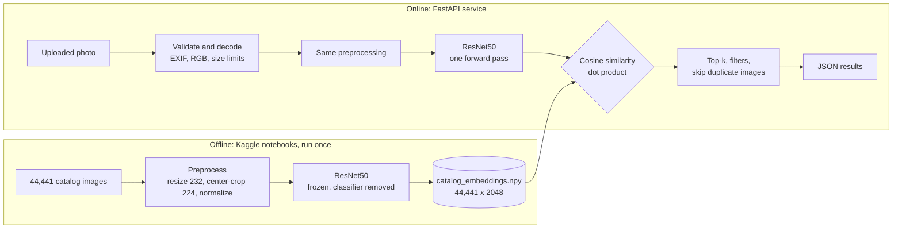

<div align="center">

# 🔍 Visual Product Finder

**Upload a photo of a fashion product and get visually similar items from a 44,441-product catalog, in a fraction of a second.**

Deep-learning image search built end to end: data validation → ResNet50 embeddings → evaluation → FastAPI service → web interface.


[](LICENSE)
[](#-the-notebooks)


</div>

---

## Contents

- [Highlights](#-highlights)
- [How it works](#-how-it-works)
- [How good is it?](#-how-good-is-it)
- [The notebooks](#-the-notebooks)
- [Quick start](#-quick-start)
- [API reference](#-api-reference)
- [Configuration](#-configuration)
- [Project structure](#-project-structure)
- [Design decisions](#-design-decisions)
- [Tests](#-tests)
- [Limitations](#-limitations)
- [Ideas for the future](#-ideas-for-the-future)
- [Data, licenses and credits](#-data-licenses-and-credits)

---

## ✨ Highlights

- **Search by image.** Upload any product photo (JPEG, PNG, WebP) and get the most similar catalog items with similarity scores.
- **No training needed.** A pretrained **ResNet50** is used as a frozen feature extractor (transfer learning). Every catalog image is turned into a 2048-number *embedding* once, offline.
- **Fast.** The catalog is never re-processed. A query costs one forward pass of the model plus a single matrix–vector product over 44,441 × 2048 numbers.
- **Evaluated honestly.** Quality is measured with a category-based proxy *and* a manual visual rating, and the limits of the proxy are stated openly ([see below](#-how-good-is-it)).
- **Query path = catalog path, and it is tested.** Uploaded photos go through exactly the same preprocessing, model and normalization as the catalog. A verification script proves it with real images.
- **A real service, not a notebook.** Typed FastAPI endpoints with automatic Swagger docs, filters, thumbnails, duplicate handling, input validation and automated tests.
- **Fails loudly, never silently.** The server refuses to start if the catalog files are inconsistent (wrong checksum, misaligned rows, unnormalized vectors).

## 🧠 How it works



1. **Embedding.** A CNN trained on ImageNet learns to detect visual patterns. If we stop it *before* its final classification layer, what remains is a numeric summary of the image: a vector of 2048 numbers. Images that look alike get vectors that point in similar directions.
2. **Similarity.** All embeddings are L2-normalized (length 1), so the **cosine similarity** between two images is simply the **dot product** of their vectors. Searching the whole catalog is `catalog @ query`.
3. **Exact search.** This is a brute-force, exact search with NumPy. Approximate indexes (e.g. FAISS) only pay off for millions of items.
4. **Duplicates.** About 3.6% of catalog products have a practically identical image. In a result list, only one product per group of identical images is shown, and the freed slot is filled with the next different product.

> Scores are cosine similarities. Compare them **only within one result list**: embeddings of a ReLU network are non-negative, so even unrelated products score well above 0. The *ranking* is what carries the meaning.

## 📊 How good is it?

Quality is checked on three levels.

### 1. Is the pipeline correct? (verified)

`scripts/verify_against_catalog.py` sends real catalog photos through the API's own pipeline (decode → preprocess → ResNet50, here on CPU in fp32) and compares the result with the stored catalog embeddings (computed on GPU in fp16).

| Check (50 random catalog products) | Result |
|---|---|
| Cosine similarity to the stored embedding | min **0.99986**, mean **0.99998** |
| Best match is the product itself (or an identical twin) | **50 / 50** |

This confirms that uploaded photos are embedded exactly like the catalog, that embeddings and product rows are aligned, and that fp16 vs fp32 makes no practical difference.

### 2. Does it retrieve the right kind of product? (category proxy)

The dataset has no human similarity judgements, only category labels. So the main metric is **precision@5**: of the 5 nearest neighbours of a query, which share has the same category as the query? 2,000 randomly chosen products (fixed random seed) are used as queries against the full 44,441-product catalog, and a product is never its own neighbour. Identical twins are **not** excluded here, so the numbers include the free hits from the roughly 3.6% of products that have a duplicate image.

| Category level | Precision@5 | Random search (chance) |
|---|---|---|
| `masterCategory` (7 groups) | **0.989** | 0.XXX |
| `subCategory` | **0.937** | 0.XXX |
| `articleType` (143 groups) | **0.816** | 0.XXX |

### 3. Does it look similar to a human? (manual rating)

Same category does not mean "looks similar" (*Casual Shoes* and *Sports Shoes* can look alike; two shirts of the same type can look nothing alike). To measure that gap, 20 queries were rated by hand, without category labels or scores shown.

| Same results, two ways of judging | Precision@5 |
|---|---|
| By visual rating (human) | 0.XXX |
| By article type (category proxy) | 0.XXX |

Full evaluation (per-category results, the most common "errors", failure examples, duplicates, a garment-versus-pose analysis and a robustness test with flipped, rotated, darkened, cropped, low-resolution and grayscale photos) is in notebook [VPF 05](https://www.kaggle.com/code/tahazarei/vpf-05-evaluation) and [VPF 04](https://www.kaggle.com/code/tahazarei/vpf-04-search-engine).

<div align="center">

</div>

## 📓 The notebooks

The whole pipeline was developed and documented in five Kaggle notebooks. The API loads exactly the files that notebook 5 produces.

| # | Notebook | What it does |
|---|---|---|
| 1 | [Fashion Dataset EDA](https://www.kaggle.com/code/tahazarei/vpf-01-fashion-dataset-eda) | Understands the data, reads the CSV safely (commas inside product names), validates every record and image, builds the clean product table |
| 2 | [Image Preprocessing](https://www.kaggle.com/code/tahazarei/vpf-02-image-preprocessing) | Builds the loading pipeline matched to the ResNet50 weights, verifies it against the official transform, studies the effect of center-cropping |
| 3 | [ResNet50 Embeddings](https://www.kaggle.com/code/tahazarei/vpf-03-resnet50-embeddings) | Extracts embeddings, traces shapes through the network, checks speed and fp16 safety, compares *crop* vs *pad* preprocessing on identical queries |
| 4 | [Search Engine](https://www.kaggle.com/code/tahazarei/vpf-04-search-engine) | Embeds the full catalog in resumable chunks, builds cosine-similarity search, tests alignment ("does an image find itself?") and robustness to modified photos |
| 5 | [Evaluation](https://www.kaggle.com/code/tahazarei/vpf-05-evaluation) | Evaluates retrieval (precision@5, failures, duplicates, manual rating) and writes the portable bundle the API loads |

The notebooks are also included in [`notebooks/`](notebooks/).

## 🚀 Quick start

**Requirements:** Python 3.10 or newer. A GPU is optional; the service runs fine on CPU.

### 1. Install

```bash
git clone https://github.com/GitT456/visual-product-finder.git
cd visual-product-finder
python -m venv .venv
```

Activate the environment:

```bash
source .venv/bin/activate          # Linux / macOS
.venv\Scripts\Activate.ps1         # Windows PowerShell
```

```bash
pip install -r requirements.txt
```

> Need a specific PyTorch build (for example CPU-only)? Install `torch` and `torchvision` first by following [pytorch.org](https://pytorch.org/get-started/locally/), then run the command above.

### 2. Get the catalog files

Download **`vpf_artifacts.zip`** from the [Releases page](https://github.com/GitT456/visual-product-finder/releases) and unzip it into `data/`:

```
data/
├── vpf_artifacts/            required
│   ├── catalog_embeddings.npy    (44,441 × 2048, float32, L2-normalized, ~364 MB)
│   ├── products.csv              (product metadata, same row order as the embeddings)
│   ├── model_config.json         (weights, preprocessing and checksum)
│   ├── search_settings.json
│   └── manifest.json
└── images/                   optional: only needed to show product pictures
    ├── 10000.jpg
    └── ...
```

### 3. Product pictures (optional)

Search works without images, but the website then shows "No image". The original dataset is many gigabytes, but the website only needs small thumbnails (about 420 px). You can create them **once on Kaggle**, without downloading the dataset:

1. Create a Kaggle notebook and attach the [Fashion Product Images dataset](https://www.kaggle.com/datasets/paramaggarwal/fashion-product-images-dataset) and the output of notebook VPF 05.
2. Paste [`scripts/make_thumbnails_kaggle.py`](scripts/make_thumbnails_kaggle.py) into a cell and run it.
3. Download `thumbnails.zip` and unzip it into `data/images/` (files are named `<id>.jpg`).

The dataset images are not redistributed in this repository.

### 4. Run

```bash
uvicorn app.main:app --host 127.0.0.1 --port 8000
```

The first start downloads the ResNet50 weights (about 100 MB, internet needed once; they are cached afterwards).

| URL | What |
|---|---|
| http://127.0.0.1:8000 | The website |
| http://127.0.0.1:8000/docs | Interactive API documentation (Swagger UI) |

<details>
<summary><b>Verify your installation (optional, recommended once)</b></summary>

```bash
python scripts/verify_against_catalog.py --images <folder with ORIGINAL catalog images> --n 50
```

The script sends catalog images through the API's own pipeline and compares the result with the stored embeddings. The cosine similarity must be about 1.0 (the check requires at least 0.999).

Use the **original** dataset images for this check. The catalog embeddings were computed from full-resolution images, so thumbnails would give a slightly lower similarity and a false alarm.

</details>

## 📡 API reference

Interactive documentation with a "Try it out" button is available at `/docs`.

| Method | Path | Description |
|---|---|---|
| `POST` | `/search` | Upload an image (multipart field `file`) and get similar products |
| `GET` | `/products/{id}/similar` | Products similar to a catalog product (the product and its identical twins are left out) |
| `GET` | `/products/{id}` | Details of one product |
| `GET` | `/images/{id}?size=400` | Product image, optionally as a thumbnail (`size` = longest side in pixels, `0` = original file) |
| `GET` | `/filters` | Values that can be used as filters |
| `GET` | `/health` | Service status, catalog size and model |
| `GET` | `/info` | Model, preprocessing, search settings and limits |

**Query parameters of the search endpoints**

| Parameter | Meaning |
|---|---|
| `k` | Number of results, 1 to 20 (default 5) |
| `dedupe` | `true` (default): show only one product among practically identical images |
| `gender`, `master_category`, `sub_category`, `article_type`, `base_colour` | Keep only products with this value (case-insensitive; see `/filters`) |

### Example

```bash
curl -X POST "http://127.0.0.1:8000/search?k=5&article_type=Watches" -F "file=@photo.jpg"
```

```json
{
  "query": {"filename": "photo.jpg", "content_type": "image/jpeg", "bytes": 84213, "width": 1080, "height": 1440},
  "k": 5,
  "results": [
    {
      "rank": 1,
      "score": 0.9102,
      "id": 12345,
      "name": "Casio Men Black Dial Watch",
      "article_type": "Watches",
      "master_category": "Accessories",
      "sub_category": "Watches",
      "gender": "Men",
      "base_colour": "Black",
      "season": "Winter",
      "year": 2016,
      "usage": "Casual",
      "image_url": "/images/12345"
    }
  ],
  "timings": {"decode_ms": 12.4, "embed_ms": 38.0, "search_ms": 14.1, "total_ms": 64.5}
}
```

*(The values only illustrate the format.)*

<details>
<summary><b>Python example</b></summary>

```python
import requests

with open("photo.jpg", "rb") as f:
    response = requests.post(
        "http://127.0.0.1:8000/search",
        params={"k": 5, "gender": "Men"},
        files={"file": f},
    )
response.raise_for_status()

for hit in response.json()["results"]:
    print(f'{hit["rank"]}. {hit["name"]}  (score {hit["score"]:.3f})')
```

</details>

### Errors

Errors are JSON objects `{"detail": "..."}`.

| Status | Cause |
|---|---|
| `400` | Not a valid or readable image; image too small or too large; unknown filter value |
| `404` | Unknown product, or image not available |
| `413` | File larger than the upload limit |
| `415` | The file is not an image |
| `422` | Invalid parameter (for example `k=0`) |
| `503` | The service is still starting |

Every response carries an `X-Process-Time-ms` header.

## 🔧 Configuration

All settings are optional environment variables.

| Variable | Default | Meaning |
|---|---|---|
| `VPF_BUNDLE_DIR` | `data/vpf_artifacts` | Folder with the catalog files |
| `VPF_IMAGE_DIR` | `data/images` (if it exists) | Folder with the catalog images or thumbnails |
| `VPF_DEVICE` | `auto` | `auto`, `cpu` or `cuda` |
| `VPF_MAX_UPLOAD_MB` | `10` | Largest accepted upload |
| `VPF_CORS_ORIGINS` | empty (same origin only) | Comma-separated origins allowed to call the API from another website |

## 📁 Project structure

```
visual-product-finder/
├── app/
│   ├── main.py        FastAPI application and endpoints
│   ├── engine.py      loads and verifies the catalog bundle, search (NumPy only)
│   ├── embedder.py    ResNet50 embedding (the only module that needs PyTorch)
│   ├── imaging.py     safe decoding of uploaded images
│   ├── schemas.py     response models (shown in /docs)
│   └── config.py      settings from environment variables
├── static/index.html  the website
├── scripts/
│   ├── verify_against_catalog.py   proves the API embeds images like the catalog was embedded
│   ├── smoke_test.py               sends one image to a running server
│   └── make_thumbnails_kaggle.py   creates display thumbnails on Kaggle
├── notebooks/         the five Kaggle notebooks (EDA → evaluation)
├── tests/             automated tests (no GPU and no PyTorch needed)
├── data/              catalog files go here (not committed, see above)
└── docs/              screenshots
```

## 🧩 Design decisions

- **The API processes queries exactly like the catalog.** Resize, crop, normalization, interpolation, weights and precision come from `model_config.json`, written by the notebooks. A verification script checks this with real images.
- **Startup checks.** The server refuses to start if the catalog bundle is inconsistent: wrong checksum, different number of embeddings and products, unnormalized embeddings, or rows out of order. A wrong answer is worse than no answer.
- **Cosine similarity is a dot product.** Because all vectors have length 1, searching 44k products is one matrix–vector product (roughly 10 ms on CPU). No index to build, no approximation error.
- **Duplicate handling.** In result lists only one product per group of identical images is shown. For `/products/{id}/similar`, identical twins of the query product are left out as well. Whether twins share the same product *name* or differ (e.g. colour variants) is analysed in notebook 5.
- **Upload handling.** The content is checked by decoding, not by trusting the file type. Limits on size and pixel count protect memory. The EXIF orientation is applied (phone photos), and transparent images are placed on a white background, like the catalog photos. Uploads are processed in memory and **never stored**.
- **Safe image serving.** Image paths come from the product table, never from the client, and cannot leave the image folder.
- **One model pass at a time.** A lock serializes the forward pass, so concurrent requests cannot interfere with each other.
- **The model is loaded once** at startup, in evaluation mode, and only the uploaded image is processed per request.

## 🧪 Tests

```bash
pip install -r requirements-dev.txt
pytest
```

The tests cover the search engine (correctness against brute force, filters, duplicates, damaged bundles), image validation, and every endpoint including error cases. They use a small synthetic catalog and a fake embedder, so they run without a GPU and without PyTorch, and they run automatically on every push through GitHub Actions. The real model path is covered by `scripts/verify_against_catalog.py`.

## 🚧 Limitations

These come from the evaluation in notebook 5, and I would rather state them than hide them:

- The model was trained on **ImageNet, not on fashion**, so it captures general visual similarity, not fashion-specific notions such as cut, fabric or style.
- **Precision is measured against category labels**, which are only a proxy for visual similarity. The manual rating covers a small sample of 20 queries and is subjective.
- Quality **drops for heavily cropped or very low-resolution photos** (notebook 4).
- For clothing **worn by a model**, similarity can be influenced by pose and framing (notebook 5, section 6).
- The catalog contains **duplicate images** (about 3.6% of products have a practically identical twin).
- The service has **no authentication and no rate limiting**. Put it behind a reverse proxy before exposing it publicly.
- It runs as a **single process** and keeps the catalog (about 360 MB) in memory.

<details>
<summary><b>Troubleshooting</b></summary>

| Problem | Likely cause |
|---|---|
| `Missing file(s) in ...` at start | `data/vpf_artifacts/` is empty or in the wrong place |
| `Checksum mismatch` | `catalog_embeddings.npy` and `model_config.json` come from different runs |
| Cannot download weights | No internet at first start; run once with internet, the weights are cached afterwards |
| Website shows "No image" | Image folder not configured (`VPF_IMAGE_DIR` or `data/images/`); search still works |
| `verify_against_catalog.py` gives low similarity | Thumbnails used instead of the original images, or different weights or preprocessing than the catalog (check `model_config.json`) |

</details>

## 🔭 Ideas for the future

These are possibilities, not promises:

- **Fine-tune on fashion data** (for example metric learning with triplet loss) to move from general to fashion-specific similarity, and measure the gain against this baseline.
- **Text + image search** with a vision-language model such as CLIP ("red floral summer dress" or an image).
- **Approximate nearest neighbours** (FAISS or similar) if the catalog grows to millions of items.
- **Production hardening:** Docker image, authentication, rate limiting, a persistent cache for thumbnails.

## 📦 Data, licenses and credits

- **Dataset:** [Fashion Product Images Dataset](https://www.kaggle.com/datasets/paramaggarwal/fashion-product-images-dataset) by Param Aggarwal on Kaggle. Please check the dataset page for its license terms. The product images are **not redistributed** in this repository; only the derived embeddings and product metadata are published as a release asset.
- **Model:** ResNet50 with `IMAGENET1K_V2` weights from [torchvision](https://pytorch.org/vision/stable/models/resnet.html); the weights are downloaded from PyTorch servers at first start.
- **Built with:** [PyTorch](https://pytorch.org), [FastAPI](https://fastapi.tiangolo.com), [NumPy](https://numpy.org), [pandas](https://pandas.pydata.org), [Pillow](https://python-pillow.org).
- The source code of this repository is released under the [MIT License](LICENSE).

## 👤 Author

**Taha Zarei** · [GitHub](https://github.com/GitT456) · [Kaggle](https://www.kaggle.com/tahazarei)

---

<div align="center">

If this project was useful or interesting to you, a ⭐ on the repository is much appreciated.

</div>
