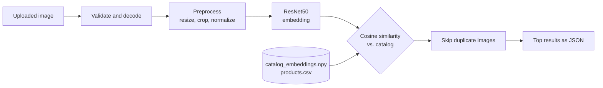

# Visual Product Finder: API and website

Upload a photo of a fashion product and get visually similar products from a catalog of 44,441 items.

The image is converted into a 2048-number **embedding** with a pretrained **ResNet50** (ImageNet weights, classifier removed).
The embedding is compared with every catalog embedding by **cosine similarity**, and the most similar products are returned.
No model is trained; the model is used as a frozen feature extractor. The notebooks that built and evaluated the
catalog are on Kaggle (*VPF 01* to *VPF 05*).



## Project structure

```
app/
  main.py        FastAPI application and endpoints
  engine.py      loads and verifies the catalog bundle, search (NumPy only)
  embedder.py    ResNet50 embedding (the only module that needs PyTorch)
  imaging.py     safe decoding of uploaded images
  schemas.py     response models (shown in /docs)
  config.py      settings from environment variables
static/index.html   the website
scripts/
  verify_against_catalog.py   proves the API embeds images like the catalog was embedded
  smoke_test.py               sends one image to a running server
tests/              41 automated tests (no GPU, no PyTorch needed)
data/               the catalog files go here (not committed, see data/README.md)
```

## Quick start

**1. Install** (Python 3.10 or newer)

```bash
python -m venv .venv
source .venv/bin/activate            # Windows: .venv\Scripts\activate
pip install -r requirements.txt
```

If you need a specific PyTorch build (for example CPU only), install `torch` and `torchvision` first, following
[pytorch.org](https://pytorch.org/get-started/locally/), then run the command above.

**2. Add the catalog files.** Download the `vpf_artifacts` folder from the Output tab of the Kaggle notebook
*VPF 05 · Evaluation* and put it in `data/vpf_artifacts/`. To show product pictures on the website, also make the dataset
images available (see `data/README.md`).

**3. Start the server**

```bash
uvicorn app.main:app --host 127.0.0.1 --port 8000
```

The first start downloads the ResNet50 weights (about 100 MB, internet needed once; they are cached afterwards).
Then open **http://127.0.0.1:8000** for the website and **http://127.0.0.1:8000/docs** for the interactive API documentation.

**4. Verify the installation** (recommended, once)

```bash
python scripts/verify_against_catalog.py --images data/images --n 50
```

This sends catalog images through the API's own pipeline and compares the result with the stored embeddings. The cosine
similarity must be about 1.0 (the check requires at least 0.999). It proves that an uploaded photo is processed exactly like
the catalog images, and that embeddings and products are aligned.

## API

| Method | Path | Description |
|--------|------|-------------|
| `POST` | `/search` | Upload an image (multipart field `file`) and get similar products |
| `GET` | `/products/{id}/similar` | Products similar to a catalog product (the product and its identical twins are left out) |
| `GET` | `/products/{id}` | Details of one product |
| `GET` | `/images/{id}?size=400` | Product image, optionally as a thumbnail (`size` = longest side, `0` = original) |
| `GET` | `/filters` | Values that can be used as filters |
| `GET` | `/health` | Service status, catalog size and model |
| `GET` | `/info` | Model, preprocessing, search settings and limits |

**Query parameters of the search endpoints**

| Parameter | Meaning |
|-----------|---------|
| `k` | Number of results, 1 to 20 (default from `search_settings.json`, 5) |
| `dedupe` | `true` (default): show only one product among practically identical images |
| `gender`, `master_category`, `sub_category`, `article_type`, `base_colour` | Keep only products with this value (case-insensitive; see `/filters`) |

**Example**

```bash
curl -X POST "http://127.0.0.1:8000/search?k=5&article_type=Watches" -F "file=@photo.jpg"
```

```json
{
  "query": {"filename": "photo.jpg", "content_type": "image/jpeg", "bytes": 84213, "width": 1080, "height": 1440},
  "k": 5,
  "results": [
    {"rank": 1, "score": 0.9102, "id": 12345, "name": "Casio Men Black Dial Watch", "article_type": "Watches",
     "master_category": "Accessories", "sub_category": "Watches", "gender": "Men", "base_colour": "Black",
     "season": "Winter", "year": 2016, "usage": "Casual", "image_url": "/images/12345"}
  ],
  "timings": {"decode_ms": 12.4, "embed_ms": 38.0, "search_ms": 14.1, "total_ms": 64.5}
}
```

(The values above only show the format.)

**Errors** are JSON objects `{"detail": "..."}`:

| Status | Cause |
|--------|-------|
| 400 | Not a valid or readable image; image too small or too large; unknown filter value |
| 404 | Unknown product, or image not available |
| 413 | File larger than the upload limit |
| 415 | The file is not an image |
| 422 | Invalid parameter (for example `k=0`) |
| 503 | The service is still starting |

## Configuration

Environment variables (all optional):

| Variable | Default | Meaning |
|----------|---------|---------|
| `VPF_BUNDLE_DIR` | `data/vpf_artifacts` | Folder with the catalog files |
| `VPF_IMAGE_DIR` | `data/images` (if it exists) | Folder with the catalog images |
| `VPF_DEVICE` | `auto` | `auto`, `cpu` or `cuda` |
| `VPF_MAX_UPLOAD_MB` | `10` | Largest accepted upload |
| `VPF_CORS_ORIGINS` | empty (same origin only) | Comma-separated origins allowed to call the API from another website |

## Design decisions

* **The API processes queries exactly like the catalog.** Resize, crop, normalization, interpolation, weights and fp16 come
  from `model_config.json`, written by the notebooks. `scripts/verify_against_catalog.py` checks this with real images.
* **Cosine similarity is a dot product.** All embeddings are L2-normalized, so searching 44k products is one matrix-vector
  product (about 10 ms). This is an exact search; an approximate index (such as FAISS) is only needed for millions of items.
* **Startup checks.** The server refuses to start if the catalog bundle is inconsistent: wrong checksum, different number
  of embeddings and products, unnormalized embeddings, or rows out of order. A wrong answer is worse than no answer.
* **Duplicate images.** About 3.6% of catalog products have an almost identical image. In a result list, only one product per
  group of identical images is shown (`dedupe`), and the freed slot is filled with the next different product. For
  `/products/{id}/similar`, identical twins of the query product are left out as well.
* **Upload handling.** Content is checked by decoding, not by trusting the file type. Limits on size and pixel count protect
  memory. The EXIF orientation is applied, and transparent images are placed on a white background. Uploads are processed
  in memory and are never stored.
* **Safe image serving.** Image paths come from the product table, never from the client, and cannot leave the image folder.
* **One model pass at a time.** A lock serializes the forward pass, so concurrent requests cannot interfere on the GPU.

## Tests

```bash
pip install -r requirements-dev.txt
pytest
```

The 41 tests cover the search engine (correctness against brute force, filters, duplicates, damaged bundles), image
validation, and every endpoint including error cases. They use a small synthetic catalog and a fake embedder, so they run
without a GPU and without PyTorch. The real model path is covered by `scripts/verify_against_catalog.py`.

## Limitations

These come from the evaluation notebook (*VPF 05*):

* The model was trained on ImageNet, not on fashion, so similarity is general visual similarity.
* Quality drops for heavily cropped or very low-resolution photos.
* For clothing worn by a model, similarity may be influenced by pose and framing.
* Evaluation used category labels as a proxy for visual similarity, plus a small manual rating.
* The service has no authentication and no rate limiting. Put it behind a reverse proxy before exposing it publicly.
* It runs as a single process and keeps the catalog (about 360 MB) in memory.

## Data and license notes

* Catalog images come from the Kaggle *Fashion Product Images* dataset. Check its license, and do not redistribute the images in this repository.
* `catalog_embeddings.npy` is about 364 MB, above GitHub's file size limit. Publish it with Git LFS or as a GitHub Release asset.
* Pretrained weights are downloaded from the PyTorch servers at first start.

## Troubleshooting

| Problem | Likely cause |
|---------|--------------|
| `Missing file(s) in ...` at start | `data/vpf_artifacts/` is empty or in the wrong place |
| `Checksum mismatch` | `catalog_embeddings.npy` and `model_config.json` come from different runs |
| Cannot download weights | No internet at first start; run once with internet, the weights are cached |
| Website shows "No image" | Image folder not configured (`VPF_IMAGE_DIR`); search still works |
| `verify_against_catalog.py` gives low similarity | Different weights or preprocessing than the catalog; check `model_config.json` |
